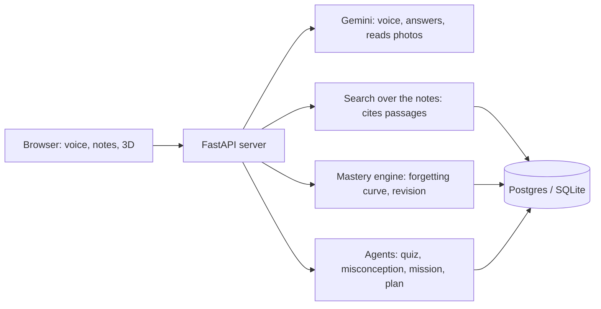

# Eklavya: a voice-first study mentor for Indian college students

[](https://github.com/visheshpandey/Eklavya/actions/workflows/ci.yml)

-b9853f)


**Live demo: https://eklavya-lime.vercel.app** (open it on a laptop, tap **Try the demo**, no sign-up).
The first load can take about a minute while the free server wakes up; the page tells you when it does.

Eklavya teaches from **your own notes**, in **English, Hindi or Hinglish**. Pick a topic and it teaches out loud while drawing
on a whiteboard, then tests you by voice, names the **exact misconception** behind a wrong answer, gives you a short study
mission, and shows your mastery rising.


## Why it exists

Students study from their own notes and syllabus PDFs with no personal tutor. A general chatbot answers from the whole internet,
cannot show where in *your* notes an answer came from, and does not track what you keep getting wrong. Most tools also ignore how
students really speak: Hinglish.

## What you can do

| | |
|---|---|
| **Ask your notes** | Every answer shows the exact passages it came from, and how many it searched. If Gemini is busy, Ask still shows the best passage with its citation. |
| **Learn, test, revise** by voice | The mentor teaches step by step with a whiteboard, then asks 3 questions. Tap an option or say the answer. |
| **Misconception diagnosis** | A wrong answer names the specific wrong belief ("divides by all real spam emails instead of the emails flagged"), saved and used for the next mission. |
| **Progress** | Mastery per topic, mastery over time, a concept map of linked topics, and the weakest topic. |
| **Study plan agent** | Builds a plan from your exam date, weights weak and fading topics, and re-plans if you miss days. |
| **Flashcards, viva, debate** | Spaced-repetition cards from your notes; an oral exam with marks; arguing against the tutor. |
| **Study groups** | Leaderboards and challenges with classmates. |
| **Works on phones and laptops** | Installable, captions on by default, text mode if there is no microphone. |

| Ask, with sources | Wrong answer: the misconception |
|---|---|
|  |  |

| Test summary | Concept map |
|---|---|
|  |  |

## Try it in two minutes (for judges)

1. Open https://eklavya-lime.vercel.app and tap **Try the demo**. You get a private demo account that nobody else can see.
2. **Ask**: "Precision aur recall mein kya difference hai?" and read the cited passages.
3. **Study room → Test**: answer Question 2 wrong on purpose and read the misconception card.
4. Finish the test and read the summary, then open **Progress** for the concept map.

Use headphones for voice. Without a microphone the same test runs in text mode.

## How it works



* **Voice:** microphone → WebSocket → Gemini Live → streamed speech and transcript. The tutor can call tools (search the notes, ask a quiz question, grade an answer, draw on the whiteboard).
* **Misconceptions:** each wrong option is written with the wrong belief it represents; otherwise Gemini classifies the mistake against a fixed list of labels. Mastery moves by a small, bounded rule. See [docs/ARCHITECTURE.md](docs/ARCHITECTURE.md).
* **Echo protection:** on laptop speakers the tutor can hear itself, so during a test the microphone is ignored while it speaks, echo-like speech is dropped, and a bare spoken letter is never graded.
* **Privacy:** each demo visitor gets a private guest account, deleted after 7 days. Gemini is called from the server only; keys live in `backend/.env`.
* **Deployed on:** Vercel (frontend), Render (backend), Neon Postgres (data).

## Quality

* 350+ backend tests and 280+ frontend tests run on every push (see the badge above).
* Real-browser checks with Playwright, a fake microphone and real Gemini.
* Lighthouse on the live site (desktop): accessibility, best practices and SEO 100.
* **Honest status:** the pilot with real students is planned, not finished. See [docs/PILOT.md](docs/PILOT.md).

## Docs

| File | What |
|---|---|
| [docs/CODEBASE.md](docs/CODEBASE.md) | **Start here:** layout, layering rules, config, errors, how to extend |
| [docs/ARCHITECTURE.md](docs/ARCHITECTURE.md) | Voice session design and key decisions |
| [docs/PRD.md](docs/PRD.md) | Product requirements |
| [docs/PILOT.md](docs/PILOT.md) | Pilot plan and how success is measured |
| [docs/CHECKLIST.md](docs/CHECKLIST.md) / [docs/LOG.md](docs/LOG.md) | Progress and decisions |

## Project structure

```
backend/    FastAPI + SQLite/Postgres: app/{api, services, agents, domain, ai, prompts}, tests/, scripts/
frontend/   plain HTML/CSS/ES modules: js/{components, controllers, services, state, lib}, tests/
samples/    ml_notes.txt (demo notes)
tools/      smoke/ (real-browser checks)
docs/
```

## Run it locally (Windows cmd)

```cmd
:: 1. backend
cd backend
pip install -r requirements.txt
copy .env.example .env
:: edit .env: set GEMINI_API_KEY (free key: https://aistudio.google.com/apikey)
python main.py

:: 2. frontend (second terminal)
cd frontend
python serve.py
```

Open http://localhost:3000 in **Chrome**. Ports: backend `PORT` in `backend/.env`; frontend `PORT` in `frontend/serve.py`;
the page finds the backend through `apiBase` in `frontend/config.js` (it must match the backend port).

## Test

```cmd
cd backend  && pip install -r requirements-dev.txt && python -m pytest tests -q
cd frontend && npm test
python backend\scripts\check_gemini.py    :: real-key check of model IDs and a live voice round trip
```

Real-browser smoke tests: see [tools/smoke/README.md](tools/smoke/README.md).

## Rules

- Keys live only in `backend/.env` (never committed); only `app/config.py` reads the environment.
- Gemini is called from the backend only. If Gemini fails the app shows a clear error, except in Ask, which then shows the best passage of the student's own notes with its citation.
